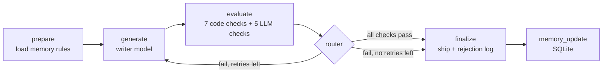

# Self-Evaluating Lesson Generator

An agent that writes a beginner lesson, **judges its own work against hard pass/fail checks**,
and rewrites until the lesson is good enough to ship. Built with Python + LangGraph.

Topic for the submission: **Introduction to RAG**.
Learner: a 12th-grade graduate from India, limited English, non-English-medium school, starting from zero in AI.



Stop rule: 1 first try + at most 2 retries. If it still fails, the best non-empty attempt (fewest fails)
is saved with `NEEDS_HUMAN_REVIEW.md` and the failure reasons. The loop always ends.

## Quick start (no API key needed, 1 minute)

```bash
python -m venv .venv && source .venv/bin/activate      # Windows: .venv\Scripts\activate
pip install -r requirements.txt
pytest                                                  # offline tests
python -m lesson_agent run --provider mock --inject-error
```

The `mock` provider uses fake models. It tests the **plumbing** (loop, retry, logs, memory).
It does **not** test lesson quality. A sample mock run is in `sample_run_mock/`.

## Real run (writes the real lesson)

```bash
cp .env.example .env          # then fill in the keys and model IDs
python -m lesson_agent run --topic "Introduction to RAG"
```

### Models and keys (free-friendly setup)

| Role | Provider value | Key variable | Model variable |
|---|---|---|---|
| Writer | `groq` (Groq) | `GROQ_API_KEY` | `qwen/qwen3.8-27b` by default |
| Judge | `gemini` (Google AI Studio) | `GEMINI_API_KEY` | `gemini-2.5-flash` by default |

Also supported: `xai` (`XAI_API_KEY`), `openai` (`OPENAI_API_KEY`), and `anthropic` (`ANTHROPIC_API_KEY`).
Set `WRITER_MODEL` or `JUDGE_MODEL` to override the defaults. Groq also accepts the legacy `XAI_API_KEY` variable if `GROQ_API_KEY` is unset.
Use two different vendors for writer and judge, so the judge does not repeat the writer's mistakes.

The code handles these API problems for you:
- Separate key and URL per provider, so Grok and Gemini work in the same run.
- `429` rate limits and `5xx`: retries with backoff and honors `Retry-After`; quota-exhausted `429` errors stop immediately.
- `CALL_INTERVAL_SECONDS` (default 4): pause between calls to one provider. Increase it for stricter token-per-minute limits.
- `400` error about `response_format` or `temperature`: retries once without those settings.
- Missing key or model: stops with a clear message.

Output goes to `outputs/<run_id>/`:

| File | What it is |
|---|---|
| `final_lesson.md` | The lesson that passed (or the best attempt if it needs review) |
| `rejection_log.md` | For each attempt: what failed, why, feedback sent, what the writer says it changed, and the real diff |
| `rejection_log.jsonl` | Same log, for machines |
| `run_summary.json` | Status, attempts, which attempt shipped |
| `attempts/attempt_N.md` | Every draft |
| `NEEDS_HUMAN_REVIEW.md` | Only when all retries fail |

## The demo commands (for the video)

```bash
python -m lesson_agent run                      # 1. full loop, end to end
python -m lesson_agent run --inject-error       # 2. evaluator catches a deliberate false sentence
python scripts/judge_reliability.py --runs 3    # 3. evaluator is stable: good lesson passes, bad lesson fails
python scripts/memory_experiment.py --runs 5    # 4. does memory help? (first-attempt pass rate, OFF vs ON)
python -m lesson_agent health                   # 5. memory + rubric health (always/never-failing checks)
```

`--inject-error` adds this false line to the "How" section of the first draft:
*"RAG retrains the model on your documents every time you ask a question."*
The grounding check must fail it, quote it, and the retry must remove it.

## The rubric (all hard pass/fail, no scores)

| # | Check | Type | Dimension |
|---|---|---|---|
| 1 | `draft_nonempty` | code | a usable draft exists |
| 2 | `sentence_length` ≤ 15 words | code | beginner language |
| 3 | `readability` Flesch ≥ 60 | code | beginner language |
| 4 | `no_idioms` (idioms, slang, e.g./i.e./etc.) | code | beginner language |
| 5 | `jargon_defined` next to first use | code | no unexplained jargon |
| 6 | `no_unexplained_terms` | LLM | no unexplained jargon |
| 7 | `claims_grounded` in the fact sheet | LLM | accurate & grounded |
| 8 | `key_points_covered` (6 key points) | LLM | covers key points |
| 9 | `lesson_length` 400–900 words | code | covers key points |
| 10 | `teaches_by_example` | LLM | teaches by example |
| 11 | `required_sections` in order | code | teaching flow |
| 12 | `flow_coherent` | LLM | teaching flow |

A lesson ships only if **all 12** pass. Edit `data/rubric.json`, `data/jargon.json`,
`data/idioms.json`, and `data/key_points.json` to change the rules. No code change needed.

## Project layout

```
data/                 rubric, fact sheet, key points, jargon list, idiom list
examples/             hand-made good lesson, bad lesson, flawed draft (test fixtures)
lesson_agent/
  graph.py            LangGraph loop and router
  generator.py        writer + error injection
  rubric.py           loads rubric, runs all checks
  checks/code_checks.py   measurable checks (Python only)
  checks/llm_judge.py     meaning checks (LLM) + safe-guards
  prompts.py          every prompt
  memory.py           SQLite memory + rubric health
  logging_utils.py    rejection log + outputs
  llm.py              Anthropic / OpenAI-compatible / mock
scripts/              judge_reliability.py, memory_experiment.py
tests/                60 offline tests
sample_run_mock/      example output from an offline run
DESIGN.md             why it is built this way
docs/VIDEO_SCRIPT.md  outline for the 15-20 minute Loom
```

## Before you submit: things only you can do

1. **Verify `data/fact_sheet.md`** line by line against the paper and docs listed at the top of that file.
   The evaluator can only be as correct as this file.
2. **Run with real models** and keep the output folder. The mock run is not the submission lesson.
3. Run `scripts/judge_reliability.py` with real models and fix any check marked UNSTABLE or WRONG.
4. Put `final_lesson.md` from the real run into a Google Doc or Notion page.

## Known limits

- `jargon_defined` checks that a definition sits next to the term. It does not judge if the definition is good. The LLM check covers meaning.
- Syllable counting is a simple rule, so Flesch scores are approximate.
- Fact sheet is small. A true claim that is not in the sheet counts as a fail. This is strict on purpose.
- Memory can show a fair effect only after several runs. Small samples are noisy.
- Empty writer replies are requested once more. Claim checks are batched and can retry missing verdicts, so judge call counts vary by lesson.
