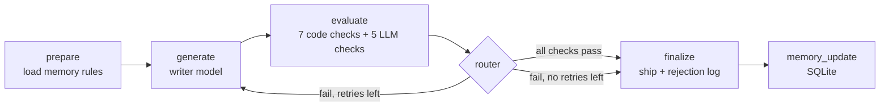

# Self-Evaluating Lesson Generator

An agent that writes a beginner lesson, **judges its own work against hard pass/fail checks**,
and rewrites until the lesson is good enough to ship. Built with Python + LangGraph.

Topic for the submission: **Introduction to RAG**.
Learner: a 12th-grade graduate from India, limited English, non-English-medium school, starting from zero in AI.



Stop rule: 1 first try + at most 2 retries (the brief's limit; a higher `MAX_RETRIES` is lowered to 2). If it still fails, the best non-empty attempt (fewest fails)
is saved with `NEEDS_HUMAN_REVIEW.md` and the failure reasons. The loop always ends.

Why it is built this way: see [DESIGN.md](DESIGN.md). It lists every design choice and trade-off.

## Mapping to the assessment

| The brief asks for | Where it is |
|---|---|
| Input: a topic | `python -m lesson_agent run --topic "Introduction to RAG"` |
| Generate a standalone beginner lesson (what, why, how) | `generator.py` + writer prompt in `prompts.py` |
| Evaluate against hard pass/fail checks, no partial credit | `data/rubric.json`: 12 checks, a lesson ships only if all 12 pass |
| The six dimensions (grounded, beginner language, examples, no jargon, key points, flow) | the `dimension` field of each check (table below) |
| Regenerate on fail with the reasons, max 1-2 retries | `graph.py`: retry loop, `MAX_RETRIES=2` |
| Output: passing lesson + rejection log | `outputs/<run_id>/final_lesson.md`, `rejection_log.md` |
| Self-evolving + memory across runs | `memory.py` (SQLite): top failures become writer rules; `health` command checks the rubric |
| Stack | Python + LangGraph |

## Quick start (no API key needed)

```bash
python -m venv .venv && source .venv/bin/activate      # Windows: .venv\Scripts\activate
pip install -r requirements.txt
pytest                                                  # offline tests
python -m lesson_agent run --provider mock --inject-error
```

The `mock` provider uses fake models. It tests the **plumbing** (loop, retry, logs, memory).
It does **not** test lesson quality. A real (not mock) sample run is in `sample_run_real/`.

## Real run

```bash
cp .env.example .env          # then add GROQ_API_KEY and GEMINI_API_KEY
python -m lesson_agent run --topic "Introduction to RAG"
```

| Role | Provider | Key variable | Default model |
|---|---|---|---|
| Writer | `groq` | `GROQ_API_KEY` | `qwen/qwen3.8-27b` |
| Judge | `gemini` | `GEMINI_API_KEY` | `gemini-flash-latest` |

`openai` also works for either role (`OPENAI_API_KEY`). Set `WRITER_MODEL` or `JUDGE_MODEL` to change a model.
Use two different vendors, so the judge does not repeat the writer's mistakes.

**Free-tier limit:** Gemini's free tier allows about **20 requests per day for each model name**.
One attempt uses 2 judge calls, so a full run uses at most 6. If you see `Out of quota`,
set `JUDGE_MODEL` to another Gemini model (each has its own daily limit) or wait.

The code retries `429` and `5xx` errors with waits (and honors `Retry-After`).
A daily-quota `429` stops at once. `CALL_INTERVAL_SECONDS` (default 4) spaces out calls to one provider.

Output goes to `outputs/<run_id>/`:

| File | What it is |
|---|---|
| `final_lesson.md` | The lesson that passed (or the best attempt if it needs review) |
| `rejection_log.md` | For each attempt: what failed, why, feedback sent, what the writer says it changed, and the real diff |
| `rejection_log.jsonl` | Same log, for machines |
| `run_summary.json` | Status, attempts, which attempt shipped |
| `attempts/attempt_N.md` | Every draft |
| `NEEDS_HUMAN_REVIEW.md` | Only when all retries fail |

## The demo commands (for the video)

```bash
python -m lesson_agent run                      # 1. full loop, end to end
python -m lesson_agent run --inject-error       # 2. evaluator catches a deliberate false sentence
python scripts/judge_reliability.py --runs 1    # 3. evaluator test: good lesson passes, bad lesson fails
python -m lesson_agent health                   # 4. memory + rubric health (always/never-failing checks)
python scripts/memory_experiment.py --runs 5    # 5. does memory help? (needs many calls: use a paid or mock judge)
```

`--inject-error` adds this false line to the "How" section of the first draft:
*"RAG retrains the model on your documents every time you ask a question."*
The grounding check must fail it, quote it, and the retry must remove it.

## The rubric (all hard pass/fail, no scores)

| # | Check | Type | Dimension |
|---|---|---|---|
| 1 | `draft_nonempty` | code | a usable draft exists |
| 2 | `sentence_length` ≤ 15 words | code | beginner language |
| 3 | `readability` Flesch ≥ 60 | code | beginner language |
| 4 | `no_idioms` (idioms, slang, e.g./i.e./etc.) | code | beginner language |
| 5 | `jargon_defined` next to first use | code | no unexplained jargon |
| 6 | `no_unexplained_terms` | LLM | no unexplained jargon |
| 7 | `claims_grounded` in the fact sheet | LLM | accurate & grounded |
| 8 | `key_points_covered` (6 key points) | LLM | covers key points |
| 9 | `lesson_length` 400–900 words | code | covers key points |
| 10 | `teaches_by_example` | LLM | teaches by example |
| 11 | `required_sections` in order | code | teaching flow |
| 12 | `flow_coherent` | LLM | teaching flow |

The 5 LLM checks use only **2 judge calls** per attempt: call 1 answers #7, call 2 answers #6, #8, #10, #12.
A lesson ships only if **all 12** pass. Edit `data/rubric.json`, `data/jargon.json`,
`data/idioms.json`, and `data/key_points.json` to change the rules. No code change needed.

## Project layout

```
data/                 rubric, fact sheet, key points, jargon list, idiom list
examples/             hand-made good lesson, bad lesson, flawed draft (test fixtures)
lesson_agent/
  graph.py            LangGraph loop and router
  generator.py        writer + error injection
  rubric.py           loads rubric, runs all checks
  checks/code_checks.py   measurable checks (Python only)
  checks/llm_judge.py     meaning checks (2 LLM calls) + safe-guards
  prompts.py          every prompt
  memory.py           SQLite memory + rubric health
  logging_utils.py    rejection log + outputs
  llm.py              one HTTP call function for Groq / Gemini / OpenAI
  mock_llm.py         offline fake models (tests only)
scripts/              judge_reliability.py, memory_experiment.py
tests/                offline tests
sample_run_real/      output of a real run: the passing lesson + rejection log
DESIGN.md             every design choice and trade-off
docs/LOOM_SCRIPT.md   the full spoken script for the Loom (what to say, start to finish)
```

## Before you submit: things only you can do

1. **Verify `data/fact_sheet.md`** line by line against the paper and docs listed at the top of that file.
   The evaluator can only be as correct as this file.
2. **Run with real models** and keep the output folder. The mock run is not the submission lesson.
3. Run `scripts/judge_reliability.py` with real models and fix any check marked UNSTABLE or WRONG.
4. Put `final_lesson.md` from the real run into a Google Doc or Notion page.

## Known limits

- `jargon_defined` checks that a definition sits next to the term. It does not judge if the definition is good. The LLM check covers meaning.
- Syllable counting is a simple rule, so Flesch scores are approximate.
- The fact sheet is small. A true claim that is not in the sheet counts as a fail. This is strict on purpose.
- The judge lists the claims itself. If it skips a sentence, that sentence is not checked.
- Memory can show a fair effect only after several runs. Small samples are noisy.
